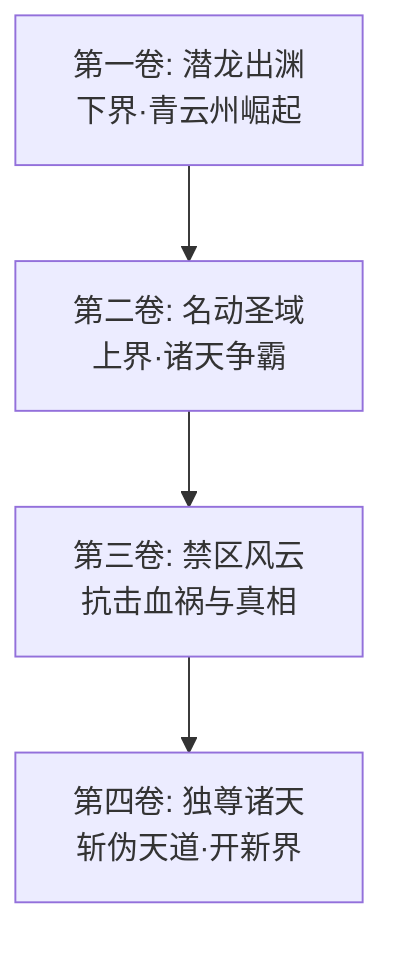

# 📖 小说大纲：《太古禁典》

## 🏷️ 核心标签
`东方玄幻` · `万界争霸` · `逆天改命` · `金手指秘宝` · `智勇双全`

---

## 🌟 一、 世界观与境界体系

### 1. 世界格局
* **下界（凡俗九州/青云小界）**：灵气稀薄，宗门林立，王朝争霸，修士以筑基立派为主。
* **上界（诸天圣域/万界战场）**：古族、圣地、神朝并存，存在禁区与古遗迹，天地法则健全。
* **禁忌之地（虚无混沌/太古墟）**：封印着太古大劫的真相与遗落的至尊兵刃。

### 2. 修炼境界划分
1. **基础五境**：练气 ➔ 筑基 ➔ 金丹 ➔ 元婴 ➔ 化神
2. **法则四境**：炼虚 ➔ 合体 ➔ 大乘 ➔ 渡劫（破空飞升）
3. **至高神境**：真仙 ➔ 仙王 ➔ 准帝 ➔ 无上大帝/道祖

---

## 👤 二、 人物设定

### 1. 主角：红果哥
* **性格特征**：果断冷静、重情重义、守底线但绝不下圣母，擅长借力打力与暗中布局。
* **暗藏机密（伏笔）**：掌握太古遗产/遗迹密宝的终极解密印记（代号 `user`，外人与读者只知其为 `user`，对应红果哥在凡俗掌握的独特隐秘信息）。
* **初始身世**：青云宗外门弃徒/落魄家族少主，因体质“隐脉阻塞”被视为废柴，实则是天地难容的**太古混沌体**。
* **核心金手指【太古禁典/神秘古塔】**：
  * **功效一·推演万法**：可推演并补全残缺功法、神通。
  * **功效二·吞炼万物**：可炼化妖兽血脉、天材地宝及敌人的本源。
  * **功效三·禁忌空间**：随修为提升解锁内部禁锢的太古强者的记忆与传承。

### 2. 核心配角
* **女主角/女强**：九天圣地圣女（身份高贵，与主角在下界因误会相识，后成为互相信任的生死挚友与伴侣）。
* **兄弟/护道者**：性格粗中有细的体修胖子 / 被封印在古塔中的太古大能残魂（良师益友）。
* **宿敌/反派**：上界天骄（重瞳者/至尊骨拥有者）、视苍生为血食的太古古族。

---

## 🗺️ 三、 分卷剧情脉络

### 第一卷：潜龙出渊（下界·青云州）
* **主线目标**：逆境崛起，肃清家族/宗门叛逆，一战成名。
* **核心剧情**：
  1. **开篇钩子**：主角遭遇陷害/退婚危机，意外激活“太古禁典”，洗髓易筋，觉醒混沌体。
  2. **逆袭崛起**：参加宗门大比/秘境试炼，夺得“化煞真灵草”，打脸曾经看不起他的天才与长老。
  3. **平定血祸**：揭开下界邪修暗中献祭城池的阴谋，斩杀邪修首领，名震青云州。
  4. **破界飞升**：触发飞升试炼塔，获得破界资格，引来上界势力的追杀。

### 第二卷：名动圣域（上界·诸天争霸）
* **主线目标**：拜入（或建立）顶级势力，同代无敌，横推诸天天骄。
* **核心剧情**：
  1. **初入上界**：因“下界修士”身份被看轻，加入落魄但有底蕴的古老宗门（如“无极道宗”）。
  2. **万界天骄榜**：红果哥以肉身与推演出的无上神通，连破神体、重瞳者，夺得榜首。
  3. **禁典觉醒**：解开禁典第二层封印，获得太古剑道传承，踏入炼虚/合体境。
  4. **结盟联手**：秘境夺宝中与九天圣女携手斩杀古族神子，确立名声与同盟关系。

### 第三卷：禁区风云与太古真相（天地浩劫）
* **主线目标**：揭开苍生浩劫真相，抗击暗黑古族与禁区至尊。
* **核心剧情**：
  1. **大劫爆发**：禁区动乱，太古古族苏醒，试图将整片大陆炼化为血祭之池。
  2. **扛起大旗**：诸多老牌圣地投敌变节，红果哥立于潮头，统领各方反抗势力。
  3. **太古墟寻真**：深入太古墟，寻找禁典起源，得知自己正是太古时代留下的唯一人族希望。
  4. **斩尊平祸**：突破大乘/渡劫境，逆斩禁区至尊，平定血祸。

### 第四卷：独尊诸天（终局大决战）
* **主线目标**：成就无上帝位，重塑宇宙规则，平定混沌虚空。
* **核心剧情**：
  1. **伪天道现身**：上苍之上/天道被污染，终极黑手（伪天道/源头邪神）现身。
  2. **证道大帝**：红果哥以自身道果融合太古禁典，身化混沌，跨入无上大帝境。
  3. **终极一战**：诸天合力，终极一战，斩灭伪天道，开辟万界新秩序。
  4. **大结局**：携手挚友红颜，隐退或踏上探索更高宇宙的征程。

---

## 🔥 四、 核心爽点与看点设计

1. **越阶战斗与打脸**：依托混沌体与禁典推演的神通，同阶秒杀，高阶反杀。
2. **功法升阶与夺宝**：普通黄阶功法经禁典推演变成帝级神通，创造出独一无二的战斗风格。
3. **智商在线的智斗与大局观**：不盲目嗜杀，注重利益借力与暗中布局，反派智商在线，冲突更有张力。
4. **宏大的史诗战争**：从个人恩怨逐步升级为种族存亡、诸天浩劫的宏大叙事。
