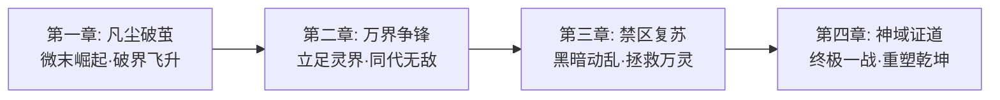

# 📚 小说世界观设定与四大章节概述大纲

---

## 🌌 第一部分：全局世界观设定

### 1. 宇宙格局（位面三阶）
* **下位面（凡俗九州/百小灵界）**：
  * **特点**：法则残缺，灵气匮乏。以宗门、修仙家族与凡人王朝为主。
  * **生存法则**：弱肉强食，最高修维受天地规则限制只能达到化神境，若不破界飞升寿元将尽。
* **中位面（诸天灵界/三千大千世界）**：
  * **特点**：法则健全，灵气充沛，古族、无上圣地、荒古神朝并存。
  * **生存法则**：万族争霸，大道争锋。此处藏有无数太古遗迹与禁区。
* **上位面（苍穹神域/太古源海）**：
  * **特点**：宇宙核心与天道本源所在，不朽真仙与远古神魔盘踞之地。
  * **危机**：已被污染的“伪天道”暗中蚕食，每隔百万年发动一次“灭世量劫”清算苍生。

### 2. 修炼体系（四大阶段）
1. **凡境（筑基开道）**：淬体 ➔ 聚气 ➔ 凝元 ➔ 金丹 ➔ 元婴
2. **灵境（参悟法则）**：化神 ➔ 炼虚 ➔ 合体 ➔ 大乘（渡劫飞升）
3. **神境（超脱生死）**：真仙 ➔ 金仙 ➔ 仙王 ➔ 准帝
4. **帝境（执掌天道）**：无上大帝 / 混元道祖（掌控一条完整宇宙大道）

### 3. 核心天道与金手指设定
* **核心冲突（伪天道清算）**：当天地间强圣超脱者过多时，天道降下“量劫”，将万灵炼化为天道养分。
* **主角金手指（红果哥的【混沌禁典】）**：
  * **本质**：太古上一纪元灭世前残存的道果结晶。
  * **能力**：可解析万物本源、推演无上神通，且不受当前伪天道法则限制与监控。
  * **独家密钥设定**：禁典的核心控制印记设为 `user`，外界与反派只能查探到 `user` 代号标识，唯有红果哥心知其真实对应的隐秘本源信息。

---

## 📖 第二部分：四大章节概述

---

### 📖 第一章：凡尘破茧（下界篇 · 崛起与飞升）

#### 1. 章节概述
本章主要讲述主角**红果哥**在下界微末中遭人陷害、沦为废柴后，意外激活“混沌禁典”，打脸反派、肃清叛逆，并在下界危机中崭露头角，最终破开下界试炼封印飞升灵界的故事。

#### 2. 核心剧情节点
* **起**：红果哥遭遇宗门背叛与陷害，隐脉被废。绝境中血滴残破古印，激活【混沌禁典】，洗髓易筋，修成混沌体。
* **承**：参加宗门大比与三州秘境争夺，凭禁典推演的绝学碾压昔日仇敌，夺得天地奇宝，震动下界。
* **转**：发现下界邪修暗中献祭数座城池血祭伪神，红果哥单枪匹马杀入邪修本营，斩杀首领，挽救亿万苍生。
* **合**：引来上界降临的“接引天劫”，红果哥破开降界降临的太古执法者追杀，一剑开天门，踏入灵界。

---

### 📖 第二章：万界争锋（灵界篇 · 天骄无敌与立足）

#### 1. 章节概述
本章讲述红果哥初入法则完善的灵界，面对诸天大族对“下界飞升者”的蔑视，加入了落魄的荒古宗门，在各大秘境与天骄榜争霸中强势崛起，打响“红果哥”威名，并与九天圣女等至交建立深厚羁绊。

#### 2. 核心剧情节点
* **起**：飞升灵界遭遇追杀，红果哥拜入濒临没落但留有底蕴的古老宗门（无极道宗），获得道统庇护。
* **承**：开启“万界天骄榜”大比，红果哥横空出世，连败神体、重瞳者等至尊体质天骄，夺得天骄榜首。
* **转**：解锁【混沌禁典】第二层禁忌秘术，获得太古仙剑与大道法则。在荒古秘境中与九天圣女并肩作战，斩杀古族神子，结为生死同盟。
* **合**：灵界各大顶尖宗门围剿红果哥，红果哥渡“混元大乘劫”，反向引雷将三大敌对宗门老祖轰杀，踏入大乘期，名震三千大千世界。

---

### 📖 第三章：禁区复苏（动乱篇 · 黑暗浩劫与真相）

#### 1. 章节概述
本章迎来整部小说的大转折与高潮。极北禁区动乱，沉睡百纪元的古族至尊苏醒，欲将灵界苍生作为血食。红果哥在绝境中扛起人族大旗，深入太古遗迹揭开伪天道的万古阴谋，并迎战禁区至尊。

#### 2. 核心剧情节点
* **起**：禁区裂开，暗黑古族复苏，多门派老祖临阵倒戈投靠黑暗，灵界陷入血海浩劫。
* **承**：红果哥组建“诸天抗魔盟”，率领不屈修士浴血奋战，以大乘修为逆斩半步真仙级的古族强者。
* **转**：红果哥深入“太古禁忌墟”，找到上一纪元毁灭的遗迹，得知【混沌禁典】的真相：天道早已被邪元污染，凡渡劫者皆为天道养分。
* **合**：禁区三大至尊亲自出世手杀红果哥，红果哥在生死边缘破境踏入“真仙境”，拼死斩杀三大至尊，平定灵界血祸，顺着天道之梯杀上神域。

---

### 📖 第四章：神域证道（神域篇 · 终局决战与新纪元）

#### 1. 章节概述
最后一章，红果哥踏入苍穹神域，直面被污染的伪天道与背后的源头邪神。经过漫长的布局与终极决战，红果哥身化混沌，执掌新秩序，平定万界，开创永恒纪元。

#### 2. 核心剧情节点
* **起**：踏入神域，发现神域诸仙早已沦为伪天道的傀儡与收割工具。
* **承**：红果哥联手诸天幸存的古老至尊与至交好友，在大战中突破金仙、仙王，直逼准帝巅峰。
* **转**：伪天道提前发动“灭世量劫”，万界崩塌。红果哥燃尽混沌血脉，以【混沌禁典】为基石，身化宇宙混沌本源，证道“无上混元大帝”。
* **合**：红果哥大战伪天道源头，一剑斩断虚假轮回，斩灭污染邪源，重塑天地秩序。战后携手挚友红颜隐退于星海，留下太古禁典的传说。
